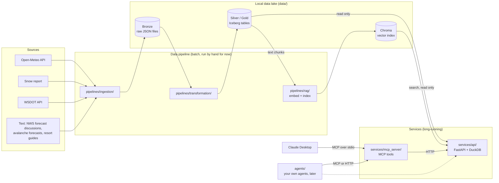
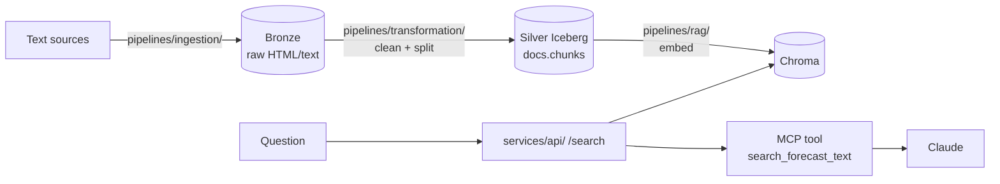

# 02 · System design

> Status: **agreed with Win on 2026-10-15.** Changes from here on go in the decisions table (§5).

## 1. Big picture



Read it left to right: **collect → clean → serve → chat.** Two kinds of code live here:
- **Pipeline jobs** (`pipelines/`) start, process a batch, and exit. They are the only things that **write** to the lake.
- **Services** (`services/`) run continuously and only **read**. The FastAPI service is the single front door to the data, and every consumer (the MCP server, your future agents, a dashboard) goes through it. That's the microservice boundary you chose.

## 2. Why this shape: the medallion layers

| Layer | Holds | Written by | Rule |
|-------|-------|-----------|------|
| **Bronze** | Raw API responses, one file per fetch, plus a small envelope (source, resort, point, fetch time, request params) | Ingest job (plain Python, `httpx`) | Never edited. If a transform has a bug, fix it and re-run from bronze. |
| **Silver** | Typed, cleaned, one row per *thing* (e.g. one forecast hour) | PySpark job | Unit-named columns (`snowfall_cm`), UTC times, history kept |
| **Gold** | Answers-shaped tables (e.g. daily outlook per resort) | PySpark job or DuckDB views | Built for the questions in the requirements |

**Why not write straight to a table?** APIs change, and parsing bugs happen. With bronze you never have to re-fetch history you can't get back (forecasts from last Tuesday are gone from the API forever).

**Why is ingest plain Python and not Spark?** Fetching a few HTTP responses is I/O, not data crunching. Spark earns its place in the transform, where we flatten arrays, cast types and MERGE into Iceberg.

## 3. Components and the tech chosen for each

| Component | Tech | Why this one | What you'll learn |
|-----------|------|--------------|-------------------|
| Project/deps | **uv** | Fast, one lockfile, runs scripts in the venv (`uv run`) | Modern Python packaging |
| Ingest | **httpx** | Simple HTTP client with timeouts and a test transport for mocking | API ingestion, retries, lineage |
| Transform | **PySpark** (local mode) | Same API you'd use on a cluster later | DataFrames, `explode`, MERGE |
| Table format | **Apache Iceberg** | ACID tables on plain files: MERGE, snapshots, time travel, schema evolution | Open table formats |
| Catalog | Iceberg **Hadoop catalog** on local disk | No server to run | What a catalog is and why the cloud needs a real one |
| Query (inside the API) | **DuckDB** + `iceberg` extension | Fast in-process SQL, no JVM, reads Iceberg directly. Used for **reading and light aggregation only**; Spark does all writes | Serving engine vs processing engine |
| API | **FastAPI** | Typed endpoints, auto docs at `/docs`, the one service that touches the lake | Publishing data as an API, Pydantic models |
| Agent tools | **MCP** (Python SDK, `FastMCP`) calling the API with `httpx` | Standard way for Claude Desktop and other agents to call your code | MCP client/server, tool design for LLMs |
| Chat | **Claude Desktop** | Runs local MCP servers over stdio | MCP client config |

## 4. Data model (weather, first pass)

**Bronze file path**
```
data/bronze/open_meteo/resort_id=crystal/point=summit/2026-10-15T224000Z.json
```

**Silver: `lake.weather.weather_hourly`**
- **Grain:** one row per `resort_id × point × valid_time × fetched_at`.
- **Key columns:** `source, resort_id, point, elevation_m, valid_time (UTC), fetched_at (UTC)`
- **Measures:** `temp_c, feels_like_c, precip_mm, rain_mm, snowfall_cm, snow_depth_m, freezing_level_m, wind_kmh, gust_kmh, weather_code, cloud_cover_pct, visibility_m`
- **Lineage:** `bronze_file`
- **Partitioning:** `resort_id, days(valid_time)` (Iceberg hidden partitioning)

**Why keep `fetched_at` in the key?** A forecast for Saturday 10am made on Tuesday and one made on Thursday are *different facts*. Keeping both answers Q6 ("is the forecast getting better?"). "Latest forecast only" becomes a simple filter.

**Gold (later): `daily_outlook`**: per resort, point and local date, the totals and extremes needed for Q1–Q5.

## 5. Key design decisions (and the alternatives)

| # | Decision | Alternative | Why we picked it |
|---|----------|-------------|------------------|
| SD1 | Fetch **two points per resort** (base and summit) by passing `elevation` to Open-Meteo | One point per resort | Rain vs snow and summit wind are the questions that matter most at Crystal |
| SD2 | Store all times in **UTC**, convert at serving time | Store local time | DST bugs disappear; resorts span time zones |
| SD3 | **Units in column names** | Separate units table | Nobody (human or LLM) can misread `snowfall_cm` |
| SD4 | **MERGE** into silver keyed on the grain | Append | Re-running is safe (idempotent) |
| SD5 | Resorts in **`config/resorts.yaml`** | Hard-coded constants | Adding Whistler = adding 10 lines of YAML |
| SD6 | **MCP server calls FastAPI over HTTP** | Shared Python query module | Other agents and tools can reuse the API; teaches the client/server split. Cost: the API must be running for MCP to work |
| SD8 | **Iceberg Hadoop catalog** (files) | SQLite SQL catalog, REST catalog | Nothing to run locally; swap for REST/Glue in the cloud |
| SD9 | **DuckDB only reads** Iceberg (`iceberg` extension) | DuckDB also transforms | One writer (Spark) keeps the lake consistent; DuckDB's Iceberg write support is still limited |
| SD10 | **Scheduling by hand** until data flows end to end | cron/launchd or Airflow now | Get correctness first, then automate |
| SD11 | **One folder per component, each its own uv package** in one repo (a uv *workspace*) | One package with sub-modules (`src/<folders>`) | Each component has only the dependencies it needs (the API doesn't install PySpark) and could be deployed on its own later |
| SD12 | **Components grouped by role**: `pipelines/`, `services/`, `libs/`, `agents/` | All components flat at the root, or one `packages/` folder | Scales to many components; the folder states the rules (services never write); maps to deployment (jobs vs containers); glob members mean new components need no root config change |
| SD13 | **Table definitions (`tables/`) separate from job logic (`jobs/`)** in `pipelines/transformation/` | DDL and transform logic in one file per job | The schema is reviewed on its own and read by people and the LLM; jobs change often. Easy to navigate as the number of tables and jobs grows |
| SD7 | **RAG only for text** (forecast discussions, avalanche forecasts, guides), see §8 | Embed everything | Numbers belong in SQL; vector search is fuzzy by design |

## 6. Folder layout

One repo, components **grouped by role** (SD12). Each component is its own small Python package with its own `pyproject.toml` and its own `src/` folder, tied together as a **uv workspace** (one lockfile, one `.venv`). Shared code lives in `libs/common/`, so no component imports from a sibling directly.

```
skiiprep/
├── pyproject.toml                  ← workspace root:
│                                     members = ["libs/*", "pipelines/*", "services/*", "agents/*"]
├── uv.lock
├── CLAUDE.md
├── config/
│   └── resorts.yaml                ← resorts and their points (shared by everything)
├── docs/                           ← requirements, design, phase guides
│
├── libs/                           ← shared code, no I/O of its own
│   └── common/                     ← package: skiiprep_common
│       └── src/skiiprep_common/
│           ├── settings.py         ← paths (data/, warehouse), env vars
│           └── resorts.py          ← load resorts.yaml into Resort/Point models
│
├── pipelines/                      ← batch jobs: run, write, exit. The ONLY writers.
│   ├── ingestion/                  ← package: skiiprep_ingestion (writes bronze)
│   │   ├── src/skiiprep_ingestion/
│   │   │   ├── sources/open_meteo.py   (later: nws_afd.py, snow_report.py, wsdot.py)
│   │   │   └── cli.py              ← `uv run ingest weather`
│   │   └── tests/
│   ├── transformation/             ← package: skiiprep_transformation (writes Iceberg)
│   │   ├── src/skiiprep_transformation/
│   │   │   ├── spark.py            ← Spark session + Iceberg catalog config
│   │   │   ├── tables/             ← table definitions (DDL) only, one file per table
│   │   │   │   └── weather_hourly.py   ← silver table `lake.weather.silver_weather_hourly`
│   │   │   ├── jobs/               ← logic: read, flatten, MERGE. Imports from tables/
│   │   │   │   └── weather_hourly.py   (later: gold jobs, docs_chunks.py)
│   │   │   └── cli.py              ← `uv run transform weather`
│   │   └── tests/
│   └── rag/                        ← later (phase 7): package skiiprep_rag (writes Chroma)
│
├── services/                       ← long-running, READ only
│   ├── api/                        ← package: skiiprep_api
│   │   ├── src/skiiprep_api/
│   │   │   ├── main.py             ← FastAPI app
│   │   │   ├── routers/weather.py
│   │   │   ├── models.py           ← Pydantic response models
│   │   │   └── db.py               ← DuckDB connection + Iceberg views
│   │   └── tests/
│   └── mcp_server/                 ← package: skiiprep_mcp (calls the API over HTTP)
│       ├── src/skiiprep_mcp/
│       │   ├── server.py           ← FastMCP tools
│       │   └── api_client.py       ← httpx client for the API
│       └── tests/
│
├── agents/                         ← later: your own agents (MCP clients)
├── orchestration/                  ← later: scheduler (not a workspace member until it has code)
├── eval/                           ← later: golden questions for RAG and agents
└── data/                           ← git-ignored
    ├── bronze/
    └── warehouse/
```

**How to read it:** the top-level folder says what a component is *allowed* to do. Anything in `pipelines/` may write data; anything in `services/` must not; `libs/` has no side effects. New components drop into the right group and the glob members pick them up.

Why `mcp_server/` and not `mcp/`? The official MCP SDK's package is called `mcp`. A local package with the same name would shadow it, and `import mcp` would pick up yours. Avoid naming your packages after libraries you use.

## 7. Resolved questions
| Question | Answer |
|----------|--------|
| Catalog | Hadoop catalog (SD8) |
| DuckDB's role | Read and serve only; Spark transforms (SD9) |
| MCP ↔ API | MCP calls FastAPI over HTTP (SD6) |
| Scheduling | By hand until end to end works (SD10) |
| Code layout | One package per component, uv workspace (SD11), grouped by role (SD12) |

## 8. RAG pipeline (phase 7)

### Why RAG here, and only here
Numbers (snowfall, wind, temperature) are answered with SQL, because "exact and fresh" is what matters. Some questions are about **prose** that no table captures: *"Why is the forecast so uncertain this weekend?"*, *"What's the avalanche problem today?"*, *"Where do I park at Crystal on a busy Saturday?"* That text is what RAG is for: find the few relevant passages and let the LLM answer from them, with citations.

### Text sources (candidates)
| Source | What it adds | Freshness | Type |
|--------|--------------|-----------|------|
| **NWS Area Forecast Discussion**, Seattle office (`api.weather.gov/products/types/AFD/locations/SEW`) | Forecasters explain the storm, confidence, snow levels | Several times a day | Online |
| **NWAC** (Northwest Avalanche Center) forecasts and mountain weather | Avalanche danger and problems, Cascades-specific weather | Daily in season | Online (check their terms) |
| Resort guides: parking, lift and terrain notes, FAQs | Practical trip tips | Rarely changes | **Offline** documents you download once |
| Your own trip notes (later) | "Last time at Crystal I…" | When you write them | Offline |

### Pipeline, using the same layers as the numbers

1. **Ingest** raw documents to bronze, exactly as with the weather JSON.
2. **Clean and chunk** in `pipelines/transformation/`: strip HTML, split into chunks, attach metadata. Chunks land in an Iceberg table `docs.chunks` (`chunk_id, doc_id, source, issued_at, section, text, text_hash`).
3. **Embed and index** in `pipelines/rag/`: turn each new chunk into a vector and upsert it into Chroma with its metadata. `text_hash` lets you skip chunks that are already embedded.
4. **Retrieve** through the API (`GET /search?q=…&source=…&since=…`), so MCP tools and your future agents use it the same way as weather data.

### Key ideas you'll learn
- **Chunking strategies.** Fixed-size with overlap is the baseline. **Structure-aware** chunking is better where documents have sections: NWS discussions are split into `.SYNOPSIS`, `.SHORT TERM`, `.LONG TERM`, `.AVIATION`, so one section can be one chunk. We'll compare both on real questions.
- **Embeddings.** A model turns text into a vector so that similar meanings land close together. Start with a free local model (Chroma's default, all-MiniLM-L6-v2), and later compare others.
- **Metadata filtering.** Forecast text goes stale fast. Filtering on `issued_at` (for example, only the latest discussion) matters as much as similarity.
- **The vector DB is an index, not the source of truth.** Chunks live in Iceberg. If you change the embedding model, you drop the Chroma collection and rebuild it from `docs.chunks`. That's the same idea as bronze → silver.
- **Evaluation.** A small "golden" list of questions with the passages that should come back, so a chunking change is measured rather than guessed.
- **Hybrid answers.** "Is Saturday worth it?" uses the SQL tools for numbers plus RAG for the forecaster's confidence and the avalanche danger. The agent decides which tools to call.

### Decisions (to confirm when we reach phase 7)
| # | Decision | Recommendation | Why |
|---|----------|---------------|-----|
| R1 | Vector DB | **Chroma** (your pick) | Simple, local, Python-first |
| R2 | Chroma mode | **Client/server** (`chroma run --path data/chroma`) | The `pipelines/rag/` job writes while the API reads; two processes opening the same embedded database folder isn't safe. It also matches your microservice choice |
| R3 | Embedding model | Chroma's default (local, free) to start | No API key; swap later and rebuild from `docs.chunks` |
| R4 | Where chunking happens | `pipelines/transformation/` (Spark or plain Python) writing `docs.chunks` | Keeps the vector store rebuildable |
| R5 | First text source | NWS Area Forecast Discussion | Free, public, structured into sections, updated often |

### Folder additions
```
pipelines/rag/                ← package: skiiprep_rag (pipeline, writes Chroma)
├── src/skiiprep_rag/
│   ├── embed.py              ← embedding model wrapper
│   ├── index.py              ← upsert new chunks into Chroma
│   └── cli.py                ← `uv run rag index`
└── tests/
eval/                         ← golden questions + retrieval scoring (later, repo root)
```
